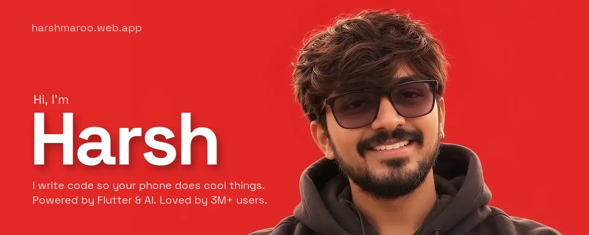

  
  
  
  

 

<picture>
  <source media="(prefers-color-scheme: dark)" srcset="assets/h-scale-dark.svg">
  
</picture>

Currently **Lead Flutter Developer at Lingopanda**. The full story, projects and case studies live at **[harshmaroo.web.app/work →](https://harshmaroo.web.app/work)**

 

<picture>
  <source media="(prefers-color-scheme: dark)" srcset="assets/h-arsenal-dark.svg">
  
</picture>

  

<picture>
  <source media="(prefers-color-scheme: dark)" srcset="assets/h-activity-dark.svg">
  
</picture>

<picture>
  <source media="(prefers-color-scheme: dark)" srcset="https://raw.githubusercontent.com/misterblack0101/misterblack0101/output/snake-dark.svg">
  
</picture>
